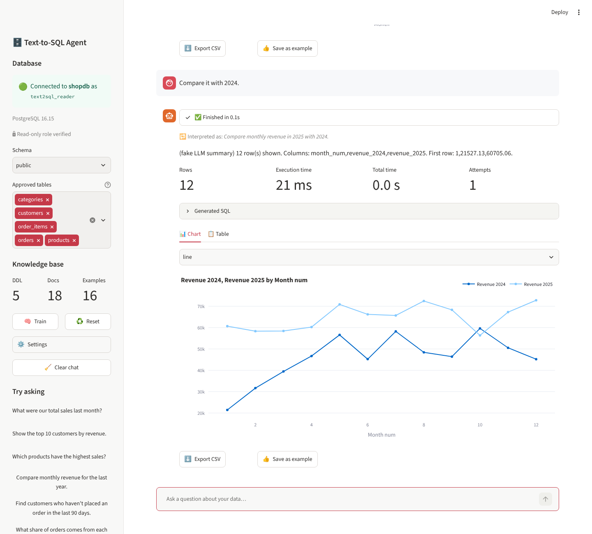
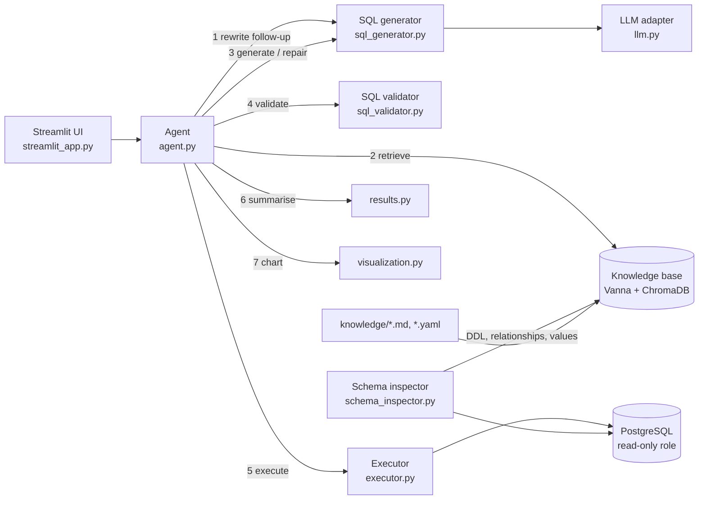

# Text-to-SQL RAG Agent

Ask questions about a PostgreSQL database in plain English and get back
**validated, read-only SQL**, a results table, an AI summary and an
automatically chosen chart.

```
"Compare monthly revenue in 2025 with 2024"
   → RAG retrieves schema, business rules, similar examples
   → LLM writes SQL → safety layer validates → read-only execution
   → table + summary + line chart
```

**Stack:** Python 3.11+ · PostgreSQL 16 · Vanna (RAG engine + ChromaDB) · OpenAI / Anthropic / Ollama / any
OpenAI-compatible LLM · Streamlit · SQLAlchemy + psycopg 3 · sqlglot · Pandas · Plotly · Docker Compose


<sub>Screenshot taken with the offline test LLM (`tests/fake_llm_server.py`), hence the "(fake LLM summary)" text.</sub>

---

## Contents
1. [Features](#features)
2. [Quick start (Docker)](#quick-start-docker)
3. [Local development](#local-development)
4. [Configuration](#configuration)
5. [Architecture](#architecture)
6. [How each component works](#how-each-component-works)
7. [Security model](#security-model)
8. [Teaching the agent (knowledge base)](#teaching-the-agent-knowledge-base)
9. [Using your own database](#using-your-own-database)
10. [CLI](#cli)
11. [Testing](#testing)
12. [Project structure](#project-structure)
13. [Troubleshooting](#troubleshooting)

---

## Features

| Area | What you get |
|---|---|
| Natural-language queries | Chat interface; works for totals, rankings, time series, comparisons, cohorts ("haven't ordered in 90 days") |
| Schema understanding | Inspects tables, columns, types, PKs, FKs, comments and the distinct values of low-cardinality columns (e.g. `orders.status`). Only tables the role can `SELECT` are visible. |
| RAG knowledge base | DDL, table descriptions, FK relationships, business definitions (markdown) and verified question→SQL pairs in ChromaDB, retrieved for each question. FK neighbours of retrieved tables are added automatically so joins are never guessed. |
| SQL generation | Prompt with rules, today's date, approved tables, retrieved context and conversation history. Responds `CANNOT_ANSWER` instead of hallucinating. |
| Safety | AST-based validator (SELECT only, single statement, no DML/DDL anywhere incl. CTEs, no dangerous functions, table allow-list, row limit) **plus** a read-only DB role, `READ ONLY` transactions, statement timeout and capped fetch. |
| Self-correction | Validation and database errors are fed back to the LLM for up to `MAX_RETRIES` repair attempts. Security violations are never retried. |
| Results | Table, AI summary, execution time, row count, CSV export, KPI cards / bar / line / pie / scatter chosen automatically (user can switch). |
| Conversation | Follow-ups ("Now only for 2025", "Compare it with 2024") are rewritten into standalone questions; previous SQL is in the prompt. |
| Learning loop | **Save as example** stores a good question→SQL pair; similar questions reuse it. |

---

## Quick start (Docker)

Prerequisites: Docker with Compose v2, and an API key for an LLM (or a local Ollama).

```bash
cp .env.example .env
# edit .env: set POSTGRES_PASSWORD, READONLY_PASSWORD, LLM_PROVIDER, LLM_MODEL, LLM_API_KEY
docker compose up -d --build
open http://localhost:8501          # or just browse to it
```

On first start PostgreSQL creates the schema, seeds about 9,000 orders (Jan 2024 up to the
day you start it) and creates the read-only role. The app inspects the schema and
trains the knowledge base automatically (`AUTO_TRAIN=true`).

Useful commands:

```bash
docker compose logs -f app                       # app logs
docker compose exec app python -m app.cli check  # connection + read-only audit
docker compose exec app python -m app.cli ask "Show the top 10 customers by revenue."
docker compose down -v && docker compose up -d   # wipe + re-seed (moves sample dates to today)
```

**Local LLM instead of an API key:**

```bash
docker compose --profile ollama up -d
docker compose exec ollama ollama pull qwen2.5-coder:7b
# .env: LLM_PROVIDER=ollama  LLM_MODEL=qwen2.5-coder:7b  LLM_BASE_URL=http://ollama:11434/v1
docker compose up -d app
```

---

## Local development

```bash
python -m venv .venv && source .venv/bin/activate      # Windows: .venv\Scripts\activate
pip install -r requirements-dev.txt
cp .env.example .env                                     # DB_HOST=localhost is the default
docker compose up -d postgres                            # or point DB_* at your own PostgreSQL
python -m app.cli check                                  # ✓ Connected … ✓ Role is read-only
python -m app.cli train                                  # optional; happens automatically on first run
streamlit run streamlit_app.py
```

Without Docker, create the database yourself:

```bash
createdb shopdb
psql -d shopdb -f db/init/01_schema.sql
psql -d shopdb -f db/init/02_seed.sql
POSTGRES_USER=$USER POSTGRES_DB=shopdb READONLY_PASSWORD=secret bash db/init/03_roles.sh
```

---

## Configuration

All settings are environment variables (or `.env`). The full annotated list is in
[`.env.example`](.env.example). The important ones:

| Variable | Default | Purpose |
|---|---|---|
| `DATABASE_URL` or `DB_HOST`/`DB_PORT`/`DB_NAME`/`DB_READONLY_USER`/`DB_READONLY_PASSWORD` | – | **Read-only** connection used by the app |
| `DB_SCHEMA` | `public` | Default schema (switchable in the sidebar) |
| `ALLOWED_TABLES` | *(all readable)* | Optional allow-list, e.g. `orders,customers` |
| `REQUIRE_READ_ONLY_ROLE` | `true` | Refuse to start if the role can write or is superuser |
| `QUERY_TIMEOUT_SECONDS` / `MAX_ROWS` / `MAX_RETRIES` | `15` / `1000` / `2` | Execution limits |
| `LLM_PROVIDER` | `openai` | `openai`, `anthropic`, `openai_compatible`, `ollama` |
| `LLM_MODEL` / `LLM_API_KEY` / `LLM_BASE_URL` | – | Model, key (falls back to `OPENAI_API_KEY`/`ANTHROPIC_API_KEY`), endpoint |
| `EMBEDDING_PROVIDER` | `default` | `default` (local MiniLM, no key), `openai`, `hashing` (offline) |
| `SUMMARY_ENABLED` / `SUMMARY_MAX_ROWS` | `true` / `50` | AI summaries, and how many result rows the LLM sees |
| `HISTORY_TURNS` | `5` | Conversation turns kept for follow-ups |

Provider examples:

```ini
# OpenAI
LLM_PROVIDER=openai
LLM_MODEL=gpt-4.1-mini
LLM_API_KEY=sk-...

# Anthropic
LLM_PROVIDER=anthropic
LLM_MODEL=claude-sonnet-5-5
LLM_API_KEY=sk-ant-...

# Any OpenAI-compatible endpoint (Azure OpenAI, Groq, Together, OpenRouter, vLLM, LM Studio, Gemini …)
LLM_PROVIDER=openai_compatible
LLM_BASE_URL=https://openrouter.ai/api/v1
LLM_MODEL=meta-llama/llama-3.3-70b-instruct
LLM_API_KEY=...
```

---

## Architecture



Request flow inside `TextToSQLAgent.ask()`:

```
question ──► standalone question (if follow-up)
         ──► retrieve DDL + docs + examples (+ FK neighbours, approved tables only)
         ──► LLM → SQL ──► validate ──invalid & fixable──► repair ─┐
                              │                                    │ ≤ MAX_RETRIES
                              └──► execute ──DB error──► repair ───┘
         ──► DataFrame ──► summary + chart recommendation ──► UI
```

`app/services.py` wires the components together from `Settings`. The UI and the CLI
both use it, so every component can be built and tested on its own.

---

## How each component works

**`app/config.py`.** Loads every setting from the environment into one `Settings` dataclass. Builds the
connection URL from parts and escapes special characters in passwords. No other module reads `os.environ`.

**`app/db.py`.** Creates a pooled SQLAlchemy engine. Every connection is opened with
`default_transaction_read_only=on` and a `statement_timeout`. `check_connection()` reports server info
and audits the role: superuser, CREATEDB/CREATEROLE, write privileges on any table, CREATE on any schema.
The app refuses to run with a writable role unless you opt out.

**`app/schema_inspector.py`.** Uses SQLAlchemy's inspector to read tables, views, columns, types, PKs, FKs
and comments, keeping only objects the role can `SELECT` (`has_table_privilege`). It samples the distinct
values of low-cardinality text columns (≤15 values, skipping PII-looking names such as `email` or
`first_name`), so the LLM knows that status is `'delivered'`, not `'Delivered'`. It renders each table as
annotated DDL plus a plain-English description.

**`app/llm.py`.** Builds the Vanna instance: Vanna's `ChromaDB_VectorStore` (RAG storage and retrieval)
combined with a small chat adapter for the configured provider. The adapters handle the provider
differences: the system-prompt format for Anthropic, `max_completion_tokens` for OpenAI, retrying
without `temperature` for reasoning models, and timeouts. Each database/schema/embedding model gets its
own Chroma directory so knowledge never mixes.

**`app/knowledge_base.py`.** The RAG layer.
`build_training_plan()` turns the inspected schema plus `knowledge/business_definitions.md` (one
document per `##` section) and `knowledge/sql_examples.yaml` into DDL, documentation and question/SQL
items. Every example is validated first, so a bad example can't teach the model a bad habit.
`train()` is idempotent because IDs are content hashes. `retrieve_context()` pulls the top-k items of
each kind, adds DDL for FK-linked tables and drops anything outside the approved tables.

**`app/sql_generator.py`.**
- `rewrite_question()` turns a follow-up into a standalone question using the recent turns (one cheap
  LLM call, only when there is history).
- `build_prompt()` assembles the rules: read-only, use only shown tables and columns, follow business
  definitions, LIMIT lists, use `CANNOT_ANSWER` when unsure. It adds today's date, the approved tables,
  the retrieved DDL, docs and examples (within a token budget), and then the previous turns as
  user/assistant messages.
- `repair()` adds the failed SQL and the exact error and asks for a fix.
- `extract_sql()` pulls SQL out of code blocks or plain text.

**`app/sql_validator.py`.** The safety gate. See the [security model](#security-model). It returns
either a normalised SQL string to execute or typed issues. Security violations are flagged, so the agent
doesn't retry them.

**`app/executor.py`.** Runs the validated SQL in a transaction opened `READ ONLY` with
`SET LOCAL statement_timeout` and `lock_timeout`, using the raw psycopg cursor with no parameters, so
`LIKE 'A%'` works. It fetches at most `MAX_ROWS + 1` rows to detect truncation, always rolls back, and
maps SQLSTATEs to clear messages: timeout, read-only violation, permission denied.

**`app/agent.py`.** Orchestrates the loop above and returns an `AgentResponse`: status, SQL, DataFrame,
timings, attempts log, summary and chart. Statuses are `success`, `blocked` (safety), `cannot_answer`
and `error`.

**`app/results.py`.** Converts driver types (Decimal → float, date → datetime64, JSON/UUID → str).
Writes the LLM summary from the question and up to `SUMMARY_MAX_ROWS` rows, with a rule-based fallback
if summaries are disabled or the call fails.

**`app/visualization.py`.** Rule-based, deterministic chart recommendation:
- one row of numbers → KPI cards
- time column + measures → line (detects real dates, and also `month`/`year`/`quarter` integers, so
  year-over-year results get one line per year)
- category + measure → bar, horizontal for many or long labels, coloured by a second category
- proportion-style question with ≤8 non-negative slices → pie
- two measures → scatter

It picks a primary money measure and won't mix scales (e.g. revenue next to customer counts).

**`streamlit_app.py`.** Chat UI. The sidebar shows connection status, the read-only check, the schema
selector, approved tables (which can narrow but never widen the allow-list), knowledge-base counts with
Train/Reset, settings and example questions. Each answer shows the interpreted question, summary,
metrics, an expandable SQL section, a self-correction log, chart and table tabs, a chart-type switcher,
CSV export and **Save as example**.

**`app/cli.py`.** Provides `check`, `inspect`, `train`, `ask` (follow-ups supported) and `validate`.

---

## Security model

Defence in depth: each layer would stop a destructive query on its own.

| Layer | Protection |
|---|---|
| 1. Prompt | The model is told it is read-only and must only use the approved tables. **Not trusted**: prompt injection is assumed possible. |
| 2. Validator (`sql_validator.py`) | Token screen for DML/DDL keywords, ignoring string literals. Full parse with sqlglot (PostgreSQL dialect). **Exactly one** statement. Root must be `SELECT`/set operation. No `INSERT/UPDATE/DELETE/MERGE/DDL/COPY/SET/…` **anywhere** in the tree, including data-modifying CTEs. No `SELECT … INTO`, no `FOR UPDATE/SHARE`. Blocked functions: `pg_sleep`, `pg_read_file`, `dblink*`, `lo_*`, `set_config`, `nextval/setval`, `query_to_xml` and the other `*_to_xml` functions (they execute SQL strings), `version()`, `current_user`, and so on. Every table must be on the allow-list. System catalogs and other schemas or databases are rejected. CTE names are handled. `LIMIT ≤ MAX_ROWS` is enforced. The SQL that runs is **re-generated from the validated AST** with comments stripped, so what executes is exactly what was checked. |
| 3. Transaction | `SET TRANSACTION READ ONLY`, `statement_timeout`, `lock_timeout`, always rolled back. |
| 4. Fetch | At most `MAX_ROWS + 1` rows are pulled into memory. |
| 5. Database role | `db/init/03_roles.sh` creates a role with `SELECT` only, `default_transaction_read_only=on`, a role-level `statement_timeout`, no access to the `internal` schema (which holds a sample `employee_salaries` table to prove it) and no CREATE anywhere. The app audits this at startup. |

**SQL injection.** User text is never concatenated into SQL by the application. The only SQL that runs
is LLM output that has passed the validator, and stacked statements, comments and dynamic-SQL functions
are rejected. Identifiers used during schema sampling are quoted with the dialect's identifier preparer.

**Data sent to the LLM.** The schema, business docs and examples are sent with each question. Result
rows (up to `SUMMARY_MAX_ROWS`) are sent only when AI summaries are on. Set `SUMMARY_ENABLED=false` to
keep result data out of the LLM entirely. Sampled column values skip PII-looking columns.

---

## Teaching the agent (knowledge base)

The agent gets better as you teach it. There are three ways:

1. **Business definitions.** Edit `knowledge/business_definitions.md`. Each `##` section becomes one
   retrievable document, for example how *revenue* is calculated, what *active customer* means, or how
   "last month" is interpreted.
2. **Verified examples.** Add question/SQL pairs to `knowledge/sql_examples.yaml`. They are validated on
   load and executed by the integration tests.
3. **From the UI.** After a good answer, click **Save as example**.

Then click **Train** in the sidebar, or run `python -m app.cli train`. Use **Reset**
(`train --reset`) after schema changes or large edits to remove stale items.

Column comments in PostgreSQL (`COMMENT ON COLUMN …`) are picked up automatically. They are the best
place for column-level meaning.

---

## Using your own database

1. Create a read-only role (adapt `db/init/03_roles.sh`: `GRANT SELECT` on the schemas you want to
   expose, nothing else).
2. Point `DB_*` (or `DATABASE_URL`) at it and set `DB_SCHEMA`. Optionally set `ALLOWED_TABLES`.
3. Replace `knowledge/business_definitions.md` and `knowledge/sql_examples.yaml` with your own
   metrics and 10–20 representative queries. This matters more than anything else for accuracy.
4. Run `python -m app.cli check` and then `python -m app.cli train --reset`.

---

## CLI

```bash
python -m app.cli check                       # connection + read-only audit
python -m app.cli inspect                     # schema as the agent sees it
python -m app.cli train [--reset]             # (re)build the knowledge base
python -m app.cli ask "Show total revenue by month." "Now only for 2025." "Compare it with 2024."
python -m app.cli validate "DELETE FROM orders"     # ✗ REJECTED: Forbidden keyword 'DELETE' …
python -m app.cli --schema sales ask "…"      # another schema
```

---

## Testing

```bash
make test                # 180 unit tests: no database, no API key
make test-integration    # + 18 tests against the compose database (or set TEST_DATABASE_URL)
```

| File | Covers |
|---|---|
| `test_sql_validator.py` | 100+ cases: valid analytics SQL, every destructive statement, stacked statements, data-modifying CTEs, `SELECT INTO`, row locks, dangerous functions, system catalogs, allow-list, quoted identifiers, row limits |
| `test_sql_generator.py` | SQL extraction, `CANNOT_ANSWER`, prompt contents (date, tables, context, history), follow-up rewriting, repair prompt |
| `test_agent.py` | Success, retry after validation/DB errors, retry exhaustion, blocking without execution, follow-ups, summary fallback, LLM failures, approved-table filtering |
| `test_knowledge_base.py` | Doc chunking, example validation, idempotent training, retrieval, FK expansion |
| `test_visualization.py`, `test_results_and_config.py` | Chart rules, normalisation, summaries, settings |
| `test_integration.py` | Read-only audit, schema inspection, DB-level write rejection, timeout, truncation, **every example query executes**, full pipeline incl. self-correction and the 3-turn follow-up conversation |
| `test_streamlit_app.py` | Headless UI test with Streamlit's `AppTest` |

The integration tests use `tests/fake_llm_server.py`, a scripted OpenAI-compatible server (not an AI)
that replays the nearest few-shot example. It lets the whole stack be tested offline through the real
OpenAI adapter. You can also run it to click around the UI without an API key:
`python tests/fake_llm_server.py` with `LLM_PROVIDER=openai_compatible`,
`LLM_BASE_URL=http://localhost:8765/v1`, `LLM_API_KEY=fake`, `LLM_MODEL=fake`. It only answers
questions close to the training examples.

See [`docs/examples.md`](docs/examples.md) for example questions with the SQL and results from the
sample database, the follow-up conversation and the safety-layer verdicts.

---

## Project structure

```
text2sql-agent/
├── app/
│   ├── config.py            # settings from env/.env
│   ├── db.py                # engine, connection check, read-only role audit
│   ├── schema_inspector.py  # tables/columns/PK/FK/comments/categorical values
│   ├── llm.py               # LLM adapters + Vanna (ChromaDB) factory + embeddings
│   ├── knowledge_base.py    # RAG: build plan, train, retrieve, FK expansion
│   ├── sql_generator.py     # prompts, follow-up rewriting, repair, SQL extraction
│   ├── sql_validator.py     # safety layer
│   ├── executor.py          # read-only, time-limited, row-capped execution
│   ├── results.py           # DataFrame normalisation + summaries
│   ├── visualization.py     # chart recommendation + Plotly figures
│   ├── agent.py             # orchestration + retry loop
│   ├── services.py          # wiring
│   └── cli.py               # command-line interface
├── streamlit_app.py         # frontend
├── knowledge/
│   ├── business_definitions.md
│   └── sql_examples.yaml
├── db/init/                 # 01_schema.sql, 02_seed.sql, 03_roles.sh
├── tests/                   # unit + integration tests, fakes, fake LLM server
├── docs/                    # examples.md, screenshots
├── Dockerfile, docker-compose.yml, Makefile
├── requirements.txt, requirements-dev.txt, pyproject.toml
└── .env.example
```

---

## Troubleshooting

| Symptom | Fix |
|---|---|
| "The database role is not read-only" | You are connecting as the admin user. Use `DB_READONLY_USER`/`DB_READONLY_PASSWORD` (or set `REQUIRE_READ_ONLY_ROLE=false` for local experiments only). |
| "LLM_MODEL is not set" / auth errors | Set `LLM_PROVIDER`, `LLM_MODEL` and `LLM_API_KEY` in `.env`, then restart. |
| "last month" returns nothing | Sample dates are fixed when the DB is first created. Re-seed with `docker compose down -v && docker compose up -d`. |
| Wrong table or column used | Add a business definition or an example for that kind of question, then click **Train**. Add `COMMENT ON COLUMN` in the database. |
| Embedding model download fails (offline) | Use the Docker image (the model is baked in), or set `EMBEDDING_PROVIDER=hashing`, or use `openai`. Run `train --reset` after switching. |
| Ollama in Docker can't be reached | Use `LLM_BASE_URL=http://host.docker.internal:11434/v1` (host) or `http://ollama:11434/v1` (compose profile). |
| Changed `.env` but nothing happened | Settings are cached by Streamlit: restart the app (`docker compose restart app`). |
